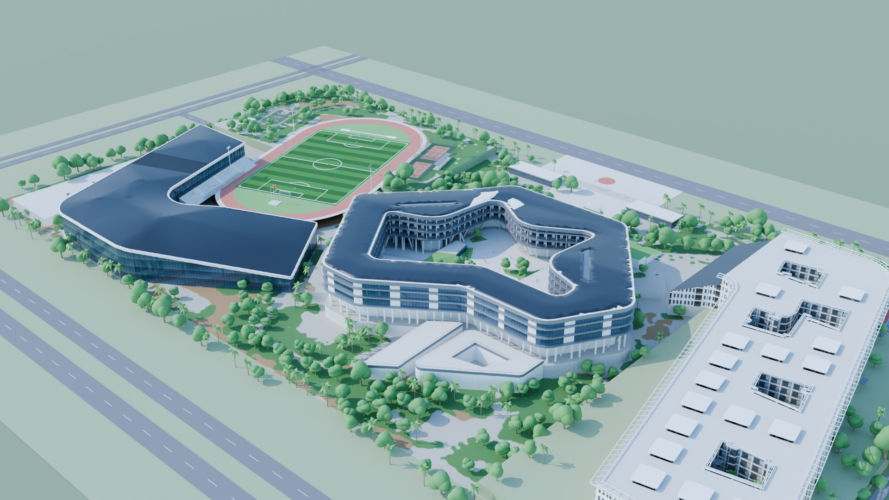
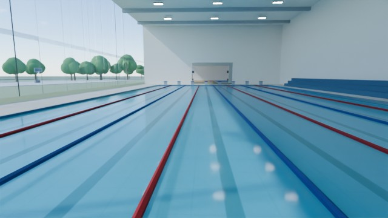
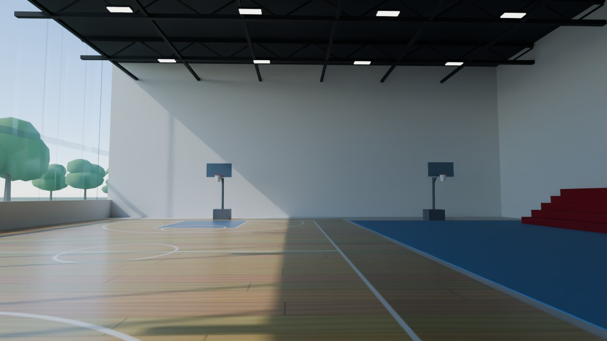
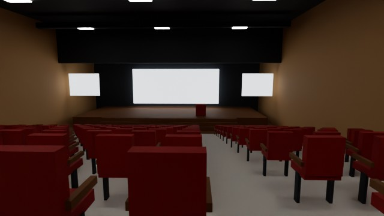
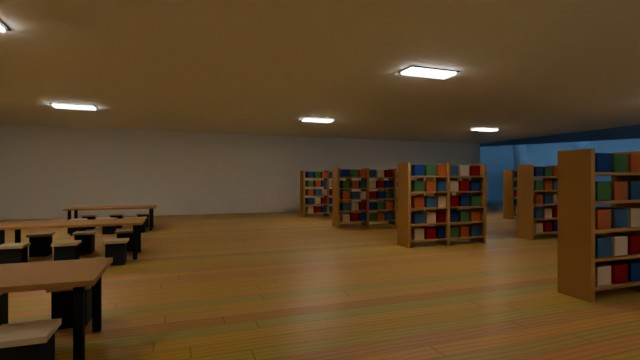
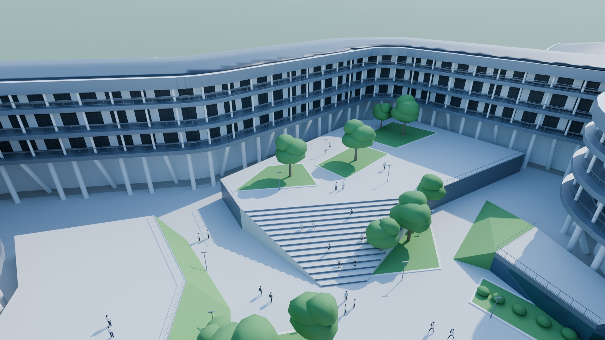
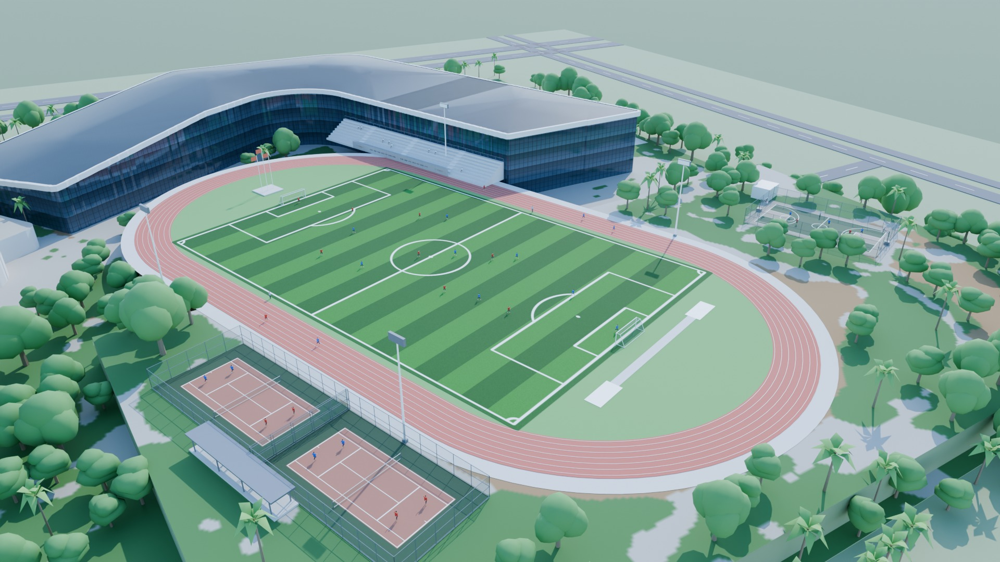
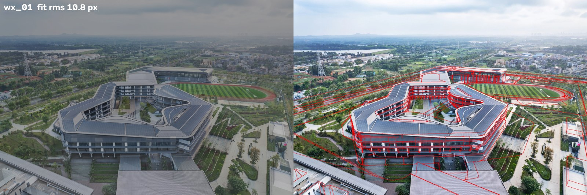

# 北大附中海口学校 · 三维校园数字孪生与沉浸漫游 (BDFZ)

<div align="center">

[](https://bdfz.leiping.dev)
[](https://threejs.org/)
[](https://vitejs.dev/)
[](https://blender.org/)
[](https://github.com/meekr/BDFZ)

**基于 Crossboundaries 官方图纸、实景摄影与卫星测绘高精度重建的三维校园数字孪生展示与第一人称内外漫游系统。**

[在线体验 (Live Preview)](https://bdfz.leiping.dev) · [功能亮点](#-核心功能亮点) · [精选图集](#-精选场景与渲染图集) · [技术架构](#-技术架构与流水线) · [快速上手](#-快速上手) · [部署指南](#-生产部署)

</div>

---

## 📸 校园鸟瞰全景

<div align="center">
  
  <p><em>▲ 校园全景鸟瞰：学术中心“云顶飘板”、宿舍庭院组团、体育艺术中心与 400 m 标准运动场</em></p>
</div>

---

## 🌟 核心功能亮点

### 1. 建筑空间图纸级高精还原
- **严格图纸标定与误差控制**：依据 Crossboundaries 2024 竣工高精度总平面图、剖面图与卫星影像进行双重坐标系注册（整体轮廓中位误差 $\le 0.2\%$）。
- **参数化与程序化几何生成**：通过 Python + Blender 自动化解算学术中心 Delaunay 坡屋顶曲面、星形内院露天看台、下沉庭院、连廊柱网与微穿孔遮阳百叶。
- **微观细节质感**：定制 400 m 国际标准跑道多道矢量标线、草坪深浅色条带修剪材质、动态微波粼粼的室内泳池水面、塑胶篮球场与师生人物模型。

### 2. 内外一体化沉浸式第一人称漫游
- **双模视角无缝切换**：支持宏观全景“鸟瞰浏览”与微观地面“第一人称漫游”秒级切换。
- **6 大室内地标深度可达**：
  1. **50 m 恒温室内游泳馆**：8 泳道、微波粼粼水体动画、16 出发台与阶梯观赛看台。
  2. **双室内篮球馆**：枫木运动地板、标准篮球架与高挑空空间钢桁架屋盖。
  3. **艺术中心大剧场**：阶梯放坡、暗红绒面多排座椅与宽幅发光主舞台。
  4. **星形庭院开放图书馆**：多排立体书架、阅读长桌与下沉式阶梯阅读区。
  5. **艺术馆西侧展厅**：展陈挂画长廊与独立雕塑展台。
  6. **示范高中宿舍单元**：按 2024 高中宿舍典型单元还原上床下桌、独立卫浴与共享休闲厅。
- **多端全平台操作适配**：支持桌面端 `WASD` 移动 + 鼠标拖拽平滑转向 + 地面单击瞬移（SDF 精准光圈指示）；移动端自适应触摸拖拽。

### 3. 高性能分包流式 GLB 加载架构
- **分层分包加载策略**：
  - 核心物理碰撞包（`nav_collision.glb`）：仅 **2 KB**，秒级完成全园可行走区域与坡道判定；
  - 室外建筑与景观主包（`bdfz.glb`）：**2.2 MB**（Draco 深度压缩），承载全校宏观模型；
  - 6 大室内场景切片包：按漫游落点按需流式拉取，大幅降低首屏流量消耗与移动端显存压力。
- **卓越渲染性能**：桌面端与移动端均能稳定跑满 **60 ~ 120 FPS**（Draw Calls 优化至 ~100 次）。

### 4. 现代化 shadcn 风格交互 HUD
- **轻量磨砂视觉系统**：采用 Zinc 中性色设计令牌与亚克力半透明磨砂质感（`backdrop-filter: blur(16px)`）。
- **丰富功能控件**：
  - **7 处精选预设视点**：支持一键平滑运镜（鸟瞰、星形庭院、北校门、宿舍庭院、体育中心、运动场、人视点）；
  - **Retina 2× 交互小地图**：440×294 像素实时渲染，带玩家动态视锥与站点呼吸高亮环；
  - **图层分立开关**：支持自由显隐建筑、景观、场地、师生人物与三维文字标牌；
  - **历史图纸叠图对比**：内嵌 2024 竣工彩图与屋顶平面图，支持透明度滑块动态对照。
- **居中高质感三维加载动效**：3D 等轴测几何棱晶浮动线框 + 实时解算百分比与贴图加载进度反馈。

---

## 🖼️ 精选场景与渲染图集

### 室内地标沉浸场景

| 50 m 室内恒温游泳馆 | 双室内篮球馆 |
| :---: | :---: |
|  |  |
| *水波粼粼动态池水 · 8 标准泳道 · 观赛席* | *枫木减震地板 · 挑空钢桁架 · 多功能场地* |

| 艺术中心大剧场 | 学术中心开放图书馆 |
| :---: | :---: |
|  |  |
| *216 席阶梯看台 · 宽幅发光舞台 · 专业灯光* | *星形庭院采光井 · 开放式阶梯阅读角* |

### 室外核心景观与运动场

| 星形内院多层阶梯活动平台 | 400 m 标准田径场与足球场 |
| :---: | :---: |
|  |  |
| *起伏露天台阶 · 连廊柱网 · 休闲草坪* | *超高清跑道矢量标线 · 真实看台退让* |

### 真实图纸与实景照片对位比对

<div align="center">
  
  <p><em>▲ 航拍实景照片与三维模型轮廓精准对齐校验（误差残差收敛在亚像素级）</em></p>
</div>

---

## 🛠️ 技术架构与流水线

```mermaid
flowchart LR
    subgraph AssetPipeline ["1. 资产与建模流水线"]
        Drawings["2024 竣工图纸 / 卫星 / 实拍"] --> Tools["Python 标定脚本 (tools/)"]
        Tools --> PyBlender["Blender 4.x Python 参数化建模 (blender/build/)"]
        PyBlender --> Bake["材质烘焙 & Draco 压缩导出"]
        Bake --> GLB["bdfz.glb (2.2M) + 室内切片 chunks"]
    end

    subgraph WebEngine ["2. Web 渲染引擎"]
        GLB --> ThreeJS["Three.js 0.187 + DracoLoader"]
        ThreeJS --> Engine["双模控制器: OrbitControls + FPSController"]
        Engine --> MinimapEngine["Retina 2D 小地图 Canvas 引擎"]
        Engine --> UI["现代化 shadcn HUD (web/src/style.css)"]
    end

    subgraph InfraDeploy ["3. 生产发布"]
        UI --> ViteBuild["Vite 8.x 生产静态打包"]
        ViteBuild --> Deploy["deploy-to-us.sh (rsync)"]
        Deploy --> Cloudflare["Cloudflare CDN (HTTPS)"]
        Cloudflare --> NginxStream["wh-us: Nginx Stream SNI + Let's Encrypt"]
        NginxStream --> Live["https://bdfz.leiping.dev"]
    end
```



### 目录结构组织

```text
BDFZ/
├── blender/                  # Blender 自动化构建体系
│   ├── build/                # Python 建模脚本 (建筑、景观、室内、人物等)
│   └── textures/             # 材质纹理贴图库 (跑道标线、法线贴图、瓷砖等)
├── checks/                   # 图纸对齐、相机匹配与多轮渲染质量检验图
├── data/                     # 空间几何标定 JSON 数据 (视点、站点、碰撞导航网格)
├── docs/                     # 历史各开发阶段记录 (P0 ~ P10)
├── renders/                  # Cycles 高清烘焙图集与展厅照片
├── tools/                    # 坐标系配准、卫星对齐与图纸纠偏工具
├── scripts/                  # 自动化生产运维脚本
│   └── deploy-to-us.sh       # US 生产节点一键打包与同步部署脚本
└── web/                      # 前端三维展示工程 (Vite + Three.js)
    ├── index.html            # 现代化轻量语义化 HTML 与 shadcn HUD 结构
    ├── src/                  # 前端源码
    │   ├── main.js           # 场景组装、分包按需拉取与事件主控制器
    │   ├── style.css         # Zinc 规范设计系统、磨砂玻璃面板与加载动效
    │   └── tour/             # 第一人称漫游核心模块 (FPS、小地图、碰撞检测)
    └── public/               # 模型 GLB 静态资产与高清叠图
```

---

## 🚀 快速上手

### 1. 本地启动开发环境

```bash
# 进入 Web 前端工程目录
cd web

# 安装依赖
npm install

# 启动秒级热更新本地开发服务器
npm run dev
```

在现代浏览器中打开控制台输出的地址（默认 `http://localhost:5173`）即可开始交互预览。

### 2. 生产环境构建

```bash
npm run build
```

产物将编译输出至 `web/dist/`，所有静态资源均已通过 Vite 进行 Hash 命名与 Draco 优化。

---

## 🌐 生产部署

本项目部署于 US 独立服务器节点，基于 Nginx Stream SNI 分流与 Let's Encrypt 证书体系，配合 Cloudflare CDN 实现全球高速分发。

若具备服务器 SSH 权限，仅需在根目录下执行一行命令：

```bash
./scripts/deploy-to-us.sh
```

该脚本将自动执行：
1. 本地执行 `npm run build` 产出优化包；
2. 增量安全同步产物至远程服务器目录 `/var/www/bdfz.leiping.dev/`；
3. 执行生产域名端点与 3D GLB 资产完整性健康检测。

---

## 📜 版权与说明

- **建筑设计版权**：© Crossboundaries
- **实景建筑摄影**：© 白羽
- **数字孪生建模与交互系统**：由 [meekr](https://github.com/meekr) 维护
- **使用条款**：本项目三维模型与图纸数据仅用于学术研讨、建筑数字化技术学习与非商业展示。
